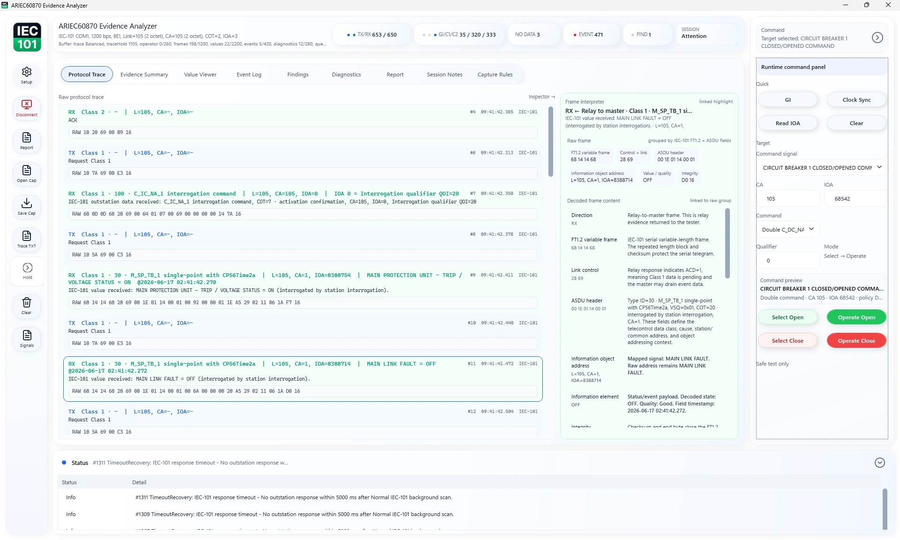

# ArSee · Open-Source IEC 60870-5-101/103/104 Protocol Tester & Analyzer

**ArSee** is the public product name. New Windows executable and release assets use `ArSee`; historical C# namespaces and user-data paths keep `ARIEC60870` for backward compatibility. The GitHub repository has been renamed to [`masarray/arsee`](https://github.com/masarray/arsee), and the canonical Pages website is [`masarray.github.io/arsee`](https://masarray.github.io/arsee/). Older repository URLs redirect; old GitHub Pages project URLs do not.

**From raw IEC 60870 traffic to inspectable engineering evidence.**

ArSee is a free, Apache-2.0 open-source Windows protocol tester and evidence analyzer for **IEC 60870-5-101, IEC 60870-5-103, and IEC 60870-5-104**. Inspect original TX/RX frames, supported protocol interpretations, Values, Events, diagnostics, and native PDF evidence for authorized FAT/SAT, commissioning support, research and troubleshooting.

**[Product website](https://masarray.github.io/arsee/)** · **[Download guide](https://masarray.github.io/arsee/download.html)** · **[Quick Start](https://masarray.github.io/arsee/quick-start.html)** · **[Field Wiki](https://masarray.github.io/arsee/wiki.html)**

## Download for Windows x64

| Release channel | Version | Official downloads | Purpose |
|---|---|---|---|
| **Latest public stable** | **v3.6.19** | **[Windows installer](https://github.com/masarray/arsee/releases/download/v3.6.19/ArSee-v3.6.19-setup-win-x64.exe)** · [Portable ZIP](https://github.com/masarray/arsee/releases/download/v3.6.19/ArSee-v3.6.19-win-x64.zip) · [SHA-256](https://github.com/masarray/arsee/releases/download/v3.6.19/SHA256SUMS.txt) | Source-verified Class-1 ACD event queue cue, profile/UX improvements, tested guarded legacy installer migration |
| **Previous stable** | **v3.6.18** | [Stable release page](https://github.com/masarray/arsee/releases/tag/v3.6.18) | Branded ArSee.exe and clean shortcut; historical previous-installation path retained |
| **Public prerelease archive** | **v3.6.17-rc.7** | [RC.7 release page](https://github.com/masarray/arsee/releases/tag/v3.6.17-rc.7) | Immutable evaluation build preceding v3.6.17 |

**The current installer, portable ZIP, and user-facing executable use `ArSee`.** Existing legacy `Programs/ARIEC60870` installations (v3.6.17/v3.6.18) must use the official v3.6.19 installer directly for folder relocation, with IEC sessions closed. Do not manually uninstall or delete `%LOCALAPPDATA%/ARIEC60870` operator settings, mappings or captures.

**Published public stable v3.6.19 (21 November 2026):** [Official ArSee Windows installer and ZIP](https://github.com/masarray/arsee/releases/tag/v3.6.19) from immutable source `b384e06b4ec435dae698ed995b02baf44499cefc`. [Package #44869528440](https://github.com/masarray/arsee/actions/runs/44869528440) and [master CI, original installed updater and genuine legacy migration FAT #44869011472](https://github.com/masarray/arsee/actions/runs/44869011472) **SUCCESS**, with WPF, xUnit, SBOM and build provenance. IEC-101 `(buffer)` denotes ACD-confirmed **Class-1 data pending** on an exact FC10→FC8 exchange, not the age of an individual FIFO event. User-observed communication on one real RTU confirms the cue appears then clears; no certification of multi-vendor RTU interoperability, lossless FIFO or energized switchgear controls.

**Historical public stable v3.6.18 (20 November 2026):** [Official ArSee installer and ZIP](https://github.com/masarray/arsee/releases/tag/v3.6.18) published from exact source `80988bc759b52c18343acbf2f0ab1a09fa09594d`. [Windows release Package #44645100994](https://github.com/masarray/arsee/actions/runs/44645100994) and [source CI, genuine v3.6.17 → ArSee installer migration and independent updater FAT #44644140702](https://github.com/masarray/arsee/actions/runs/44644140702) **SUCCESS**. Fixed duplicate old Start Menu shortcuts and renamed the installed user executable **ArSee.exe**; safe in-place upgrade preserves user data. Physical RTU/SCADA FAT is still separate.

**Historical public stable v3.6.17 (19 November 2026):** [Official stable release](https://github.com/masarray/arsee/releases/tag/v3.6.17) and [source-bound Package #44540333243](https://github.com/masarray/arsee/actions/runs/44540333243) **SUCCESS**, with Windows installer, portable ZIP, SHA-256, SPDX SBOM and provenance. [Master CI/native independent installed-updater FAT #44539045530](https://github.com/masarray/arsee/actions/runs/44539045530) **SUCCESS** on the immutable stable tag source `5b1eada52cb26295dd91d73afe3b9d065e71a404`. This is software release qualification; physical RTU FAT remains separate.

**Archived public RC.7 (19 November 2026):** The [release](https://github.com/masarray/arsee/releases/tag/v3.6.17-rc.7) includes concise FC10/FC11 “Class 1/2 Data Polling” tooltips, a Latest Event button that matches actual auto-scroll state, and preceding bilingual Help Center and Signal Map improvements. [Exact tagged-source Windows packaging #44478198266](https://github.com/masarray/arsee/actions/runs/44478198266) **passed**, with installer, portable ZIP, checksum, SPDX SBOM, attestation and WPF acceptance. This is **a public prerelease**, not a stable or physical FAT-certified product; the superseding public stable release is v3.6.17.

**Previous stable v3.6.16 (18 November 2026):** PRs [#248](https://github.com/masarray/arsee/pull/248), [#250](https://github.com/masarray/arsee/pull/250), [#251](https://github.com/masarray/arsee/pull/251), [#252](https://github.com/masarray/arsee/pull/252), and [#253](https://github.com/masarray/arsee/pull/253) deliver a grid-first Signal Map with search/filter, atomic spreadsheet-like paste, Fill Down, Undo/Redo, shared toolbar styles, and a resizable on-demand Scaling/Mapping inspector. Windows package [workflow #44230597646](https://github.com/masarray/arsee/actions/runs/44230597646) passed. This does not establish physical RTU FAT.

**Release qualification:** public stable v3.6.19 is an unsigned, source-qualified software package, **not an IEC/SCADA field-conformance certificate**. Compare [v3.6.19 SHA-256](https://github.com/masarray/arsee/releases/download/v3.6.19/SHA256SUMS.txt), inspect [official release notes](https://github.com/masarray/arsee/releases/tag/v3.6.19) and validate project signal scaling against independent field references. Hardware interoperability FAT remains separate.

  

*Illustrative product media. The [v3.6.19 release workflow](https://github.com/masarray/arsee/actions/runs/44869528440) verifies the public installer and packaged Windows evidence. This does not certify physical RTU interoperability.*

## Engineering-unit scaling in Signal List

IEC-101/104 measurements may be transmitted as **normalized TI9/10/21/34**, **signed scaled TI11/12/35**, or **IEEE float TI13/14/36**. Enter authorized RTU engineering scaling using **Factor** or **TwoPoint X0/X100/Y0/Y100** on the selected signal. The display projection does not rewrite original HEX, IOA, timestamps or quality; TI13 identity is appropriate if the gateway already sends MW. For the bundled 31-point CA105 reference, the **operator-mapped** TI11 Q ranges now use TwoPoint: Feeder/Diri Sendiri IOA790447 ±2078 MVar, Kopel/Lab SOGI 3 IOA790439 ±260 MVar, and Trafo/Lab SOGI 4 IOA790443 ±260 MVar, with decoded signed SVA X=-32768..32767. These are operator-provided display ranges awaiting physical RTU/SCADA FAT, not universal values. Existing user Signal Lists are kept; **Signal List → Sync 31 I/O → Save As** can apply them to exact-match legacy identity rows only without overwriting custom calibrations. POAQ feedback remains 0–1200; POOP command remains 0–1000. In v3.6.15, measured analog points open **Engineering Scaling** immediately and place X0/X100/Y0/Y100 above the fold. See the [scaling guide](docs/IEC10X_ENGINEERING_SCALING.md).

## Supported engineering workflows

| Area | What you can inspect |
|---|---|
| **IEC-101 active serial (unbalanced)** | Serial link and Class 1/2 polling, GI and selected command protocol evidence |
| **IEC-101 dual-link A/B** | Independent active/standby link states and redundancy trial diagnostics, **not certified production redundancy** |
| **IEC-101 passive** | Receive-only evidence interpretation from configured capture connections; electrical isolation depends on hardware |
| **IEC-103 active serial** | Relay protocol exchanges and supported event/value interpretation |
| **IEC-104 TCP/IP** | TCP session, APCI and ASDU data, STARTDT/TESTFR and transaction evidence |
| **Engineer workstation** | Raw Frames, Values, Events, GI/Controls where available, selected-frame inspector and contextual Smart Findings |
| **Reporting** | Native PDF evidence export with source frame references |

## Reliability and forensic foundations inherited from v3.6.13

- **IEC-101 single/A/B link reliability:** one bounded physical COM transaction/FCB authority, delayed-response quarantine and independent reconnect/backoff without blind command replay (#219–#225).
- **Truthful GI/SBO/IEC-104:** command epoch/feedback correlation, source-bound GI ACTCON/ACTTERM, and IEC-104 TCP association validation (#226–#230).
- **SOE and mapping:** per-object spontaneous accounting, bounded evidence FIFO and source-qualified mapped names in live/offline traces (#229).

- **Consistent engineering signal names:** IOA profile names now align across Values, Events, Frame Trace, History search and CSV, and offline captures (PR #210); ambiguous/unmapped points remain unguessed.

- **IEC-101 service-matched replies:** delayed FC11 status cannot complete another request; E5 cannot verify first link identity or FC9; unsupported A2 is rejected, and busy DFC prevents A/B standby promotion. See [PR #208](https://github.com/masarray/arsee/pull/208).

- **Event Journal → Original Frame:** context-aware live-follow, historical paging and navigation to captured TX/RX frames. Missing original TX is reported as incomplete evidence rather than invented.
- **Bay-aware SCADA labels:** the **bundled 31-point utility I/O example** distinguishes FEEDER, KOPEL, TRAFO CB/Local-Remote, relevant commands, busbar voltage and RTU alarms. Invalid CA/IOA/IEC Type ID families fail closed; existing user-owned profiles are **not automatically overwritten**.
- **IEC-101 at 1,200 bps:** bounded baud-aware FT1.2 frame completion after a physical start, persistent RX framing across polls per COM epoch, and regression tests for incomplete telegrams and ambiguous E5. This does **not** prove physical RTU interoperability.
- **Windows upgrade assurance:** operator-approved updates for the **installed** edition (portable ZIP does not self-replace), qualified by native Windows updater FAT, full xUnit regressions and real-WPF acceptance on the [exact source commit](https://github.com/masarray/arsee/actions/runs/43997921951).

Read [v3.6.13 release notes](https://github.com/masarray/arsee/releases/tag/v3.6.13) and [package / provenance workflow](https://github.com/masarray/arsee/actions/runs/44001183168). The [shared IEC-101 transaction core draft #145](https://github.com/masarray/arsee/pull/145) was **closed superseded** after focused integration milestones. **FIELD FAT PENDING:** physical SICAM A8000 1,200-bps SOE 60/500/2,000 batches, GI/SBO lifecycle, COM recovery and A/B failover.

An acknowledged frame or GI termination is **not** proof that every configured point was received or that a physical control operated.

## Five-minute first run

1. Download [v3.6.19 official ArSee installer](https://github.com/masarray/arsee/releases/download/v3.6.19/ArSee-v3.6.19-setup-win-x64.exe) or [portable ZIP](https://github.com/masarray/arsee/releases/download/v3.6.19/ArSee-v3.6.19-win-x64.zip), and compare the official [SHA-256](https://github.com/masarray/arsee/releases/download/v3.6.19/SHA256SUMS.txt). For old program-folder installations, close active sessions and run official Setup directly; do **not** manually uninstall or delete saved `%LOCALAPPDATA%/ARIEC60870` user data. [Previous stable v3.6.18](https://github.com/masarray/arsee/releases/tag/v3.6.18) remains available.
2. In **Setup**, choose IEC-101 serial, IEC-101 passive, IEC-103 serial or IEC-104 TCP and enter the project-approved COM/TCP, serial handshake, link and ASDU address settings.
3. Connect only to an **authorized simulator or isolated test endpoint**. Do not guess RTS/DTR states or reset a live outstation.
4. Compare original TX/RX frame evidence with the interpretation in Raw Frames, Values, Events and GI/Controls as available.
5. Export native PDF evidence, then sanitize topology, project and customer identifiers before sharing.

Further documentation: [User Guide](docs/USER_GUIDE.md) · [Quick Start](docs/QUICK_START.md) · [Testing Strategy](docs/TESTING_STRATEGY.md) · [IEC-101 A/B field checklist](docs/IEC101_DUAL_LINK_FAT_CHECKLIST.md) · [Release notes](docs/RELEASE_NOTES.md).

## Scope and safety boundaries

- **Full IEC-101 SICAM A8000 physical interoperability is not certified.** Independently reviewed link/transaction/COM/GI/SBO changes #219–#230 are included in v3.6.13; [historical PR #145](https://github.com/masarray/arsee/pull/145) was closed superseded and is not a releasable integration branch. Physical COM recovery, GI/SBO feedback and 1,200-bps SOE FIFO need field FAT.
- IEC-101 **balanced mode**, universal multi-vendor interoperability, industrial FIFO/SOE endurance, and electrically isolated 2/4-port capture are not certified.
- **HOLD** pins the visible trace viewport while acquisition continues; it does not itself guarantee durable archival recording.
- ArSee is **not** a production SCADA master, gateway, safety device or accredited IEC conformance test suite. Use active functions on approved isolated benches only.

## Build, inspect and contribute

The WPF UI, IEC protocol components and typed evidence engine live under `src/`; six test projects and site hygiene checks live in `tests/`. The English/Indonesian public landing site is maintained in `site/`, with a generated fallback mirror in `docs/`.

The [CI workflow](https://github.com/masarray/arsee/actions/workflows/ci.yml) covers Release build, protocol regression and Windows WPF acceptance. The [Package workflow](https://github.com/masarray/arsee/actions/runs/44001183168) verifies the *actual published executable* and builds ZIP, installer, checksums, SBOM and provenance. These are software checks, **not physical FAT**.

Read [Contributing](CONTRIBUTING.md), [Security](SECURITY.md), [Support](SUPPORT.md), [Code of Conduct](CODE_OF_CONDUCT.md), [Changelog](CHANGELOG.md), [License](LICENSE) and [Third-party notices](THIRD_PARTY_NOTICES.md). Apache-2.0 permits commercial use under its terms; ARIEC60870 requires no subscription or activation key.

For issues, [send a reproducible report](https://github.com/masarray/arsee/issues) with sanitized TX/RX HEX, version, OS, protocol profile and steps. Never publish sensitive captures, credentials or private substation topology.
