# ArSee · IEC 60870 Protocol Tester & Analyzer

**Understand the exchange. Find the issue. Keep the evidence.**

ArSee is a **free, open-source Windows engineering tool** for **IEC 60870-5-101, IEC 60870-5-103 and IEC 60870-5-104**. Inspect original TX/RX frames alongside decoded values, events, diagnostics and evidence-linked findings, then prepare a native PDF report for engineering review.

**[Product website](https://masarray.github.io/arsee/)** · **[Download](https://masarray.github.io/arsee/download.html)** · **[Watch the demo](https://masarray.github.io/arsee/demo.html)** · **[Quick Start](https://masarray.github.io/arsee/quick-start.html)** · **[Field Wiki](https://masarray.github.io/arsee/wiki.html)**

## See ArSee in action

  <a href="https://masarray.github.io/arsee/demo.html">
    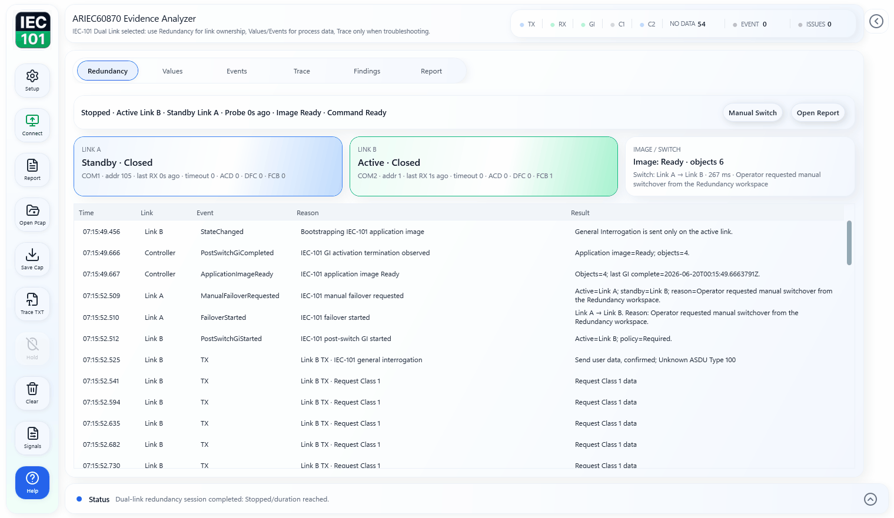
  </a>

<a href="docs/assets/screenshots/IEC-60870.gif">Open the original animated GIF</a> · <a href="https://masarray.github.io/arsee/demo.html">Watch the website demo</a>

## Download for Windows x64

**Latest public stable: [v3.6.20](https://github.com/masarray/arsee/releases/tag/v3.6.20)** · Free to use · No subscription or activation key.

| Package | Official download |
| --- | --- |
| **Installer** — per-user Windows setup | [ArSee v3.6.20 Setup EXE](https://github.com/masarray/arsee/releases/download/v3.6.20/ArSee-v3.6.20-setup-win-x64.exe) |
| **Portable** — extract and run | [ArSee v3.6.20 ZIP](https://github.com/masarray/arsee/releases/download/v3.6.20/ArSee-v3.6.20-win-x64.zip) |
| **Integrity & release notes** | [SHA-256 checksums](https://github.com/masarray/arsee/releases/download/v3.6.20/SHA256SUMS.txt) · [Versioned release](https://github.com/masarray/arsee/releases/tag/v3.6.20) |

Official release packages may be unsigned. Use the [download guide](https://masarray.github.io/arsee/download.html) for setup, portable use and upgrade guidance.

## Interface screenshots

See the actual Windows application directly in this README. Click a screenshot for its original resolution.

| Signal monitoring | Event investigation |
| :---: | :---: |
| <a href="docs/assets/screenshots/ariec60870-value-viewer.webp">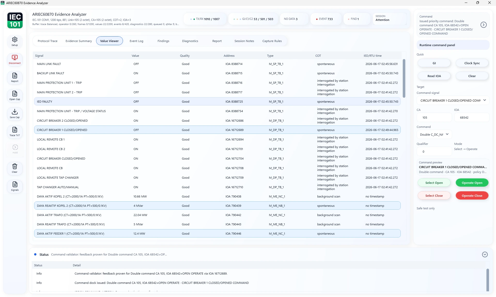</a> | <a href="docs/assets/screenshots/ariec60870-event-log.webp">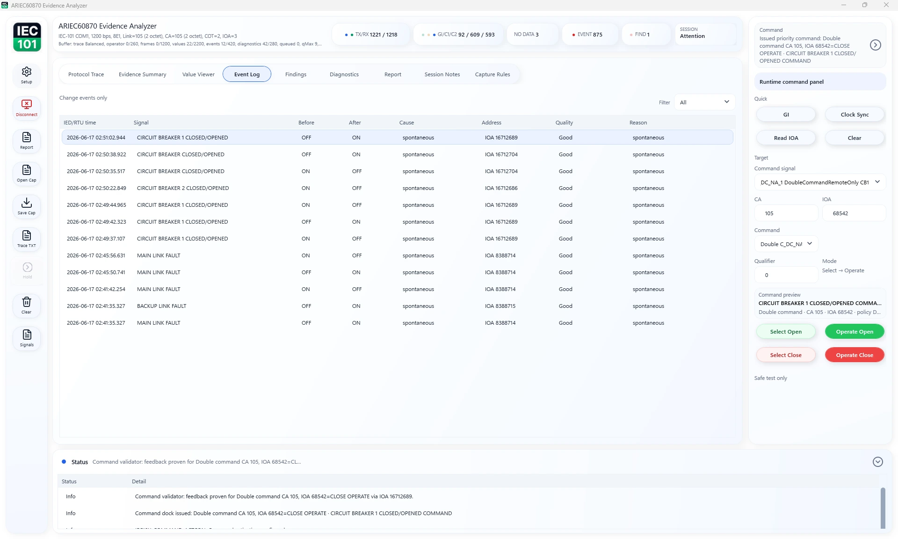</a> |
| **Values Viewer** — live decoded point values | **Event Journal** — observations and timestamps |
| <a href="docs/assets/screenshots/ariec60870-frame-trace.webp">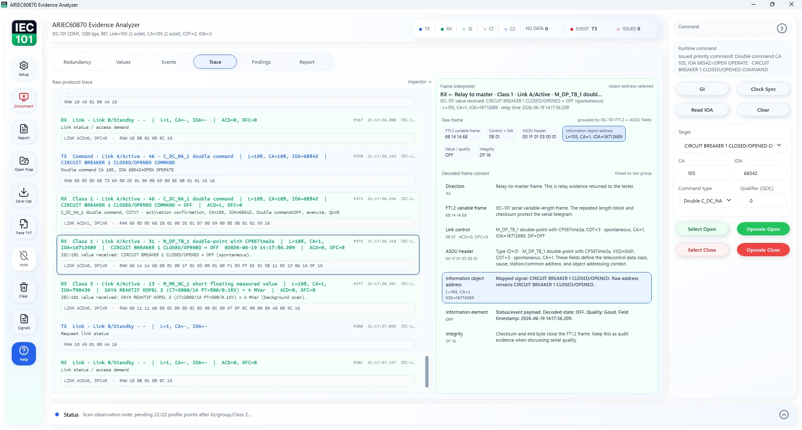</a> | <a href="docs/assets/screenshots/ariec60870-diagnostics.webp">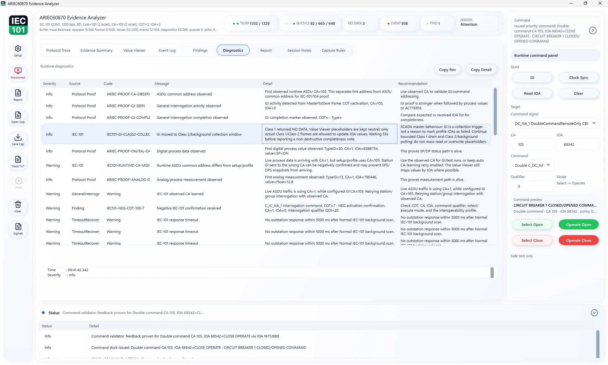</a> |
| **Frame Trace** — original TX/RX evidence | **Diagnostics** — link and protocol behavior |
| <a href="docs/assets/screenshots/ariec60870-signal-list-editor.webp">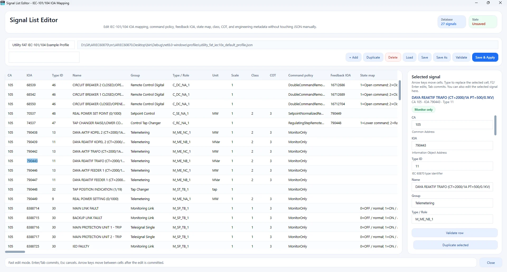</a> | <a href="docs/assets/screenshots/ariec60870-smart-findings.webp">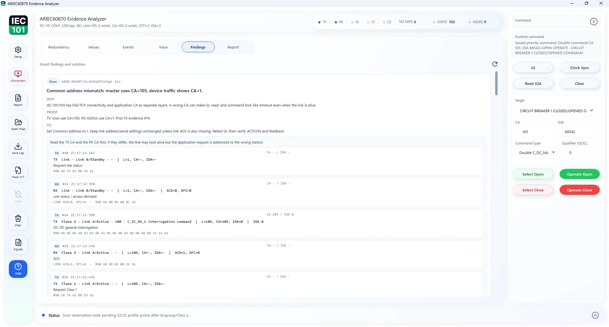</a> |
| **Signal Map** — engineer-owned point mapping | **Smart Findings** — evidence-led explanations |
| <a href="docs/assets/screenshots/ariec60870-report-workspace.webp">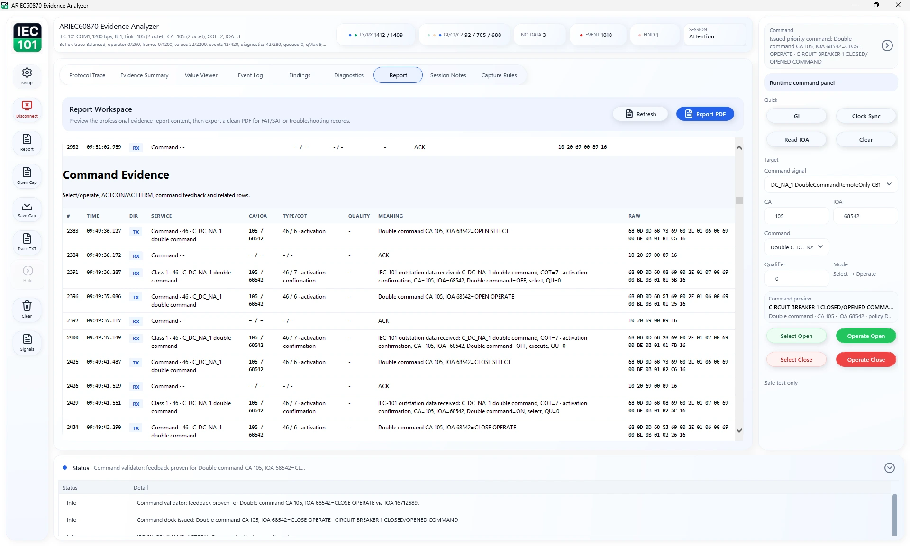</a> | <a href="docs/assets/screenshots/ariec60870-pdf-report.webp">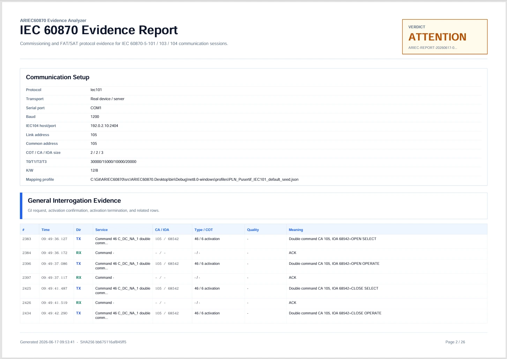</a> |
| **Report Workspace** — preview before export | **PDF Evidence** — document the session |
| <a href="docs/assets/screenshots/ariec60870-iec101-setup.webp">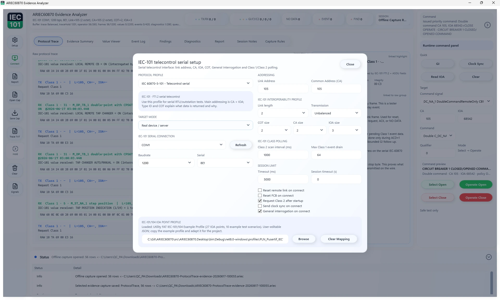</a> | <a href="docs/assets/screenshots/ariec60870-iec103-setup.webp">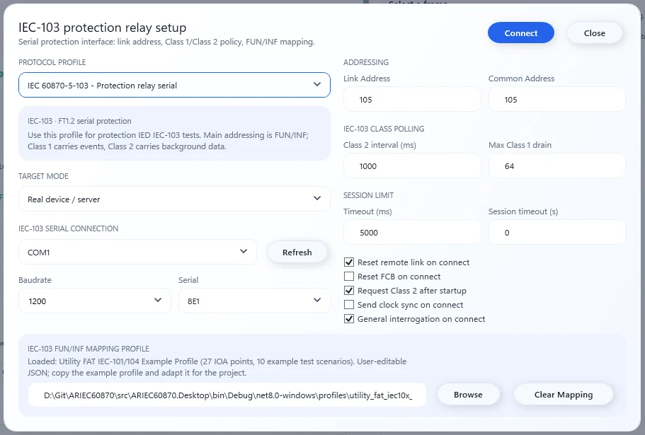</a> |
| **IEC-101 Setup** — RTU serial parameters | **IEC-103 Setup** — protection relay parameters |

<a href="docs/assets/screenshots/ariec60870-iec104-setup.webp">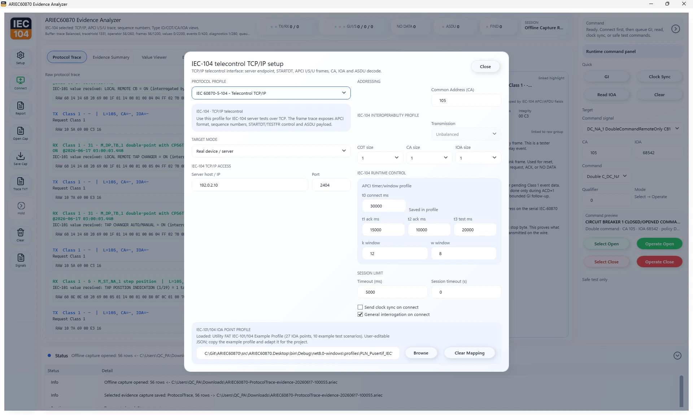</a>

IEC-104 Setup — TCP/IP communication profile

## From a connection symptom to engineering evidence

When a serial or TCP session looks connected but SCADA values are missing, the next question is **what actually happened on the wire?** ArSee connects the original protocol frames with their interpretation so engineers can move from symptoms to supporting observations.

| Workflow | What you can inspect |
| --- | --- |
| **Connect and observe** | IEC-101 active unbalanced single/A-B serial, IEC-103 serial and IEC-104 TCP, plus separate receive-only IEC-101 monitoring |
| **Inspect the exchange** | Original TX/RX telegrams, selected-frame interpretation, protocol fields, addresses, errors and diagnostics |
| **Understand the signals** | Value snapshots, events, project-specific signal mapping and engineering-unit scaling |
| **Investigate issues** | Smart Findings, GI and command-feedback evidence where supported, with source-frame references |
| **Document the work** | Evidence report preview and native PDF export |

The original communication remains inspectable even when decoding is incomplete or a signal has no project mapping.

## Practical workflow

1. **Configure** IEC-101/103 serial or IEC-104 TCP using authorized project parameters; passive and offline workflows are available where appropriate.
2. **Connect or capture** and observe what ArSee received or transmitted in Frame Trace.
3. **Investigate** the relevant Values, Events, GI/Controls and Smart Findings; follow references back to original evidence.
4. **Document** the session with the built-in PDF report.

**[Explore screenshots and the demo](https://masarray.github.io/arsee/demo.html)** · [Step-by-step Quick Start](https://masarray.github.io/arsee/quick-start.html) · [Full User Guide](docs/USER_GUIDE.md)

## Detailed feature reference

ArSee is designed around a practical path: **Configure → Connect / Capture → Observe → Investigate → Report**. The tables below describe supported engineering workflows; the exact protocol mode and published build determine which controls are available.

### IEC 60870-5-101 · Serial RTU and gateway testing

| Feature | Engineering use |
| --- | --- |
| **Active unbalanced master** | Configure COM port, baud rate, framing, link address, ASDU field lengths and device-specific startup settings. |
| **Link-layer interpretation** | Observe FT1.2 telegram structure, link functions, ACD/DFC, acknowledged responses and Class 1/Class 2 polling. |
| **General Interrogation (GI)** | Observe the request, confirmations, returned data and termination as separate protocol milestones. The configured on-connect GI policy is respected. |
| **Commands and feedback** | Inspect supported reads, time synchronization and direct/select-before-operate command transactions in authorized test sessions. |
| **Dual-link A/B** | Observe independent link health, active/standby ownership, switchover reasons and Redundancy timeline details. |
| **Passive RX-only monitor** | Receive-only serial observation, including supported multi-RX monitoring workflows; electrical isolation depends on hardware. |
| **Serial recovery diagnostics** | Distinguish link status, incomplete frames and reconnect behavior without fabricating values or command outcomes. |

### IEC 60870-5-103 · Protection relay testing

- Serial master communication with configurable port, serial profile and link address.
- Link exchange and reset visibility, supported relay Class 1/Class 2 polling and event diagnostics.
- Supported **FUN/INF** interpretation, relay indications, measured values and event timestamps where provided.
- Project-specific mapping for relay signal identities; unknown vendor information stays explicitly unclassified.

### IEC 60870-5-104 · TCP/IP testing

- TCP client/master connection to project-approved IEC-104 endpoints.
- I-format, S-format and U-format frame interpretation with sequence and session context.
- **STARTDT / STOPDT / TESTFR** control exchange and supported ASDU data inspection.
- General Interrogation, spontaneous event/value analysis and supported command-feedback evidence.
- Source-aware diagnostics for session continuity and transaction behavior.

### Frame Trace, protocol decoder and diagnostics

- **Original TX/RX evidence:** inspect observed telegrams alongside selected-frame interpretation; undecodable or malformed bytes remain visible as raw evidence.
- **Detailed protocol fields:** Type ID, Cause of Transmission, Common Address, IOA, flags, quality and timestamps; IEC-103 FUN/INF and IEC-104 APCI where applicable.
- **Operator investigation:** search, inspect, navigate history and use supported AUTO/HOLD viewport controls without conflating display following with traffic capture.
- **Communication diagnostics:** investigate missing data even when a serial link or TCP socket appears connected; inspect GI/command phase observations and protocol irregularities.
- **Evidence links:** where available, move from event/finding context to an original source frame rather than using a guessed interpretation.

### Values, Event Journal and Signal Map

| Workspace | What it provides |
| --- | --- |
| **Values Viewer** | Current decoded point states, analog measurements, counts and available quality flags. |
| **Event Journal / SOE** | Time-ordered decoded observations, digital/analog filters, search and source timestamps when supplied; missing device time is not invented. |
| **Signal List** | User-defined CA/IOA/Type ID identities, Bay/TYPE/Mnemonic names and state mappings; applicable IEC-103 FUN/INF mapping. |
| **Engineering scaling** | Factor and two-point **X0/X100/Y0/Y100** conversion for applicable normalized/scaled measurements without altering the original telegram. |
| **Mapping editor** | Search/filter, selection and spreadsheet-style editing, validated paste, Fill Down and Undo/Redo where supported. |
| **Profile preservation** | Existing user mappings remain user-owned. Reference profile ranges are examples, not universal RTU engineering units. |

### General Interrogation, Controls and Redundancy

- **GI status:** differentiate original request, ACTCON, GI data and ACTTERM. Completion of one phase is not proof that every configured signal arrived.
- **Command Panel:** supported Read IOA, clock sync, control qualifier and select/execute workflows with response and timeout evidence, where available in the selected mode.
- **Feedback truth:** distinguish a protocol confirmation, negative confirmation, missing feedback and actual physical operation; ArSee does not assume a breaker moved.
- **IEC-101 A/B:** inspect active/standby state, selected Reason/Result timeline and link-specific evidence without treating the two COM connections as one source.

### Smart Findings and Operator Evidence

- Contextual findings for supported issues such as **Common Address mismatch, GI gaps, missing ACTCON/ACTTERM, command timeout and IEC-104 session instability**.
- Findings emphasize **problem, protocol proof, possible cause and next action**, not unexplained scores.
- Events, trace and findings preserve source references where available; a missing original TX frame is shown as incomplete evidence rather than manufactured.
- Separates observed facts from inferred explanations and uncertain or unsupported protocol content.

### Captures, exports and native reporting

- Save and reopen supported capture evidence for offline investigation; archived completeness is distinct from an on-screen bounded trace.
- Supported **Trace TXT, Events CSV and capture** workflows alongside source-aware report content.
- Integrated **native PDF** preview/export with communications evidence, event details and findings where present.
- Review or redact confidential station names, IP addresses, signal details and customer identifiers before sharing.

### User experience, learning and distribution

- Compact Windows engineering desktop with **Setup, Trace, Values, Events, Diagnostics, Signal Mapping, Controls, GI, Redundancy and Report** workspaces as applicable.
- Bilingual **English and Indonesian Help Center / Field Wiki**, step-by-step guidance, trace-lab examples and troubleshooting documentation.
- Windows x64 **installer and portable ZIP**, with stable-channel update behavior for installed editions and explicit manual updates for portable ZIP.
- Published **Apache-2.0 source, CI, SHA-256 checksums, SBOM and build provenance** for release traceability.

For configuration details, see the [User Guide](docs/USER_GUIDE.md), [Quick Start](docs/QUICK_START.md), [Protocol Coverage](https://masarray.github.io/arsee/protocol-coverage.html) and [Field Wiki](https://masarray.github.io/arsee/wiki.html). Screenshots are interface illustrations, not claims of universal interoperability.

## Open source and traceable releases

ArSee is published under **Apache-2.0** with a public source tree, contribution and security policies, automated CI and versioned Windows releases. Release packages include published SHA-256 hashes and software supply-chain metadata.

**[Source code](https://github.com/masarray/arsee/tree/master/src)** · **[CI](https://github.com/masarray/arsee/actions/workflows/ci.yml)** · **[Windows package workflow](https://github.com/masarray/arsee/actions/runs/44898156357)** · **[Security](SECURITY.md)** · **[Changelog](CHANGELOG.md)**

These controls support transparency and traceability of the software build. They do not imply accredited IEC conformance or universal physical RTU interoperability.

## Compatibility and scope

**Upgrading legacy installations:** The Windows executable is **`ArSee.exe`**. New installers and release assets use **ArSee**, while legacy user data paths remain compatible. For v3.6.17/v3.6.18 installed under `Programs/ARIEC60870`, close active IEC/capture sessions and run the official v3.6.20 installer directly. Preserve `%LOCALAPPDATA%/ARIEC60870` user data and mappings. [Migration guidance](docs/RELEASE_INSTALL_FOLDER_MIGRATION_v3.6.19.md).

ArSee is an engineering tester/analyzer, **not a production SCADA master or an accredited conformance test suite**. Use active operations only on authorized systems. A protocol acknowledgment does not by itself prove physical control operation. IEC-101 balanced mode and universal multi-vendor compatibility are not advertised.

## Learn and contribute

[Field Wiki](https://masarray.github.io/arsee/wiki.html) · [Quick Start](docs/QUICK_START.md) · [Troubleshooting](docs/TROUBLESHOOTING.md) · [Architecture](docs/ARCHITECTURE.md) · [Roadmap](docs/ROADMAP.md) · [Release history](CHANGELOG.md)

[Contributing](CONTRIBUTING.md) · [Issues](https://github.com/masarray/arsee/issues) · [Support](SUPPORT.md) · [Code of Conduct](CODE_OF_CONDUCT.md) · [License](LICENSE) · [Third-party notices](THIRD_PARTY_NOTICES.md)

Remove sensitive customer identifiers, credentials, topology and private captures before submitting public reports.
