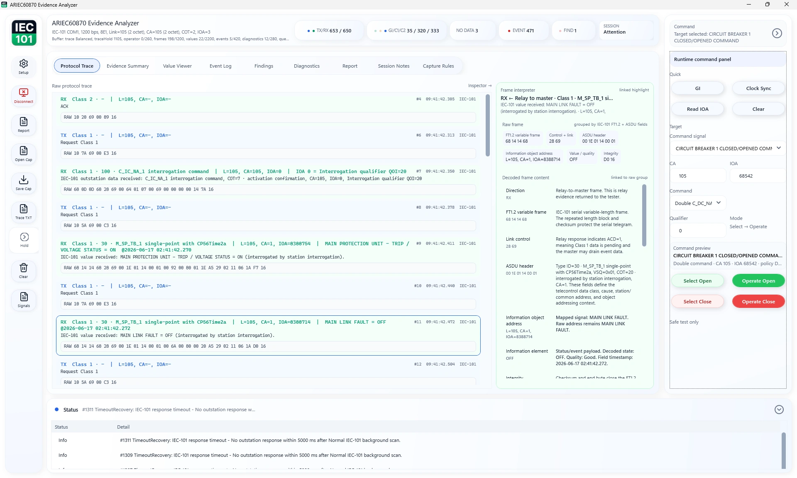

# ArSee · Open Source IEC 60870-104/103/101 Protocol Tester

**ArSee is the product identity of this existing ARIEC60870 repository, preserving old GitHub URLs, releases and file compatibility.**

**From raw IEC 60870 traffic to inspectable engineering evidence.**

ArSee is a free, Apache-2.0 open-source Windows protocol tester and evidence analyzer for **IEC 60870-5-101, IEC 60870-5-103, and IEC 60870-5-104**. Inspect original TX/RX frames, supported protocol interpretations, Values, Events, diagnostics, and native PDF evidence for authorized FAT/SAT, commissioning support, research and troubleshooting.

**[Product website](https://masarray.github.io/ARIEC60870/)** · **[Download guide](https://masarray.github.io/ARIEC60870/download.html)** · **[Quick Start](https://masarray.github.io/ARIEC60870/quick-start.html)** · **[Field Wiki](https://masarray.github.io/ARIEC60870/wiki.html)**

## Download for Windows x64

| Release channel | Version | Official downloads | Purpose |
|---|---|---|---|
| **Latest public prerelease** | **v3.6.8-rc.5** | **[Windows installer](https://github.com/masarray/ARIEC60870/releases/download/v3.6.8-rc.5/ARIEC60870-v3.6.8-rc.5-setup-win-x64.exe)** · [Portable ZIP](https://github.com/masarray/ARIEC60870/releases/download/v3.6.8-rc.5/ARIEC60870-v3.6.8-rc.5-win-x64.zip) | Engineering RC: updated Frame Interpreter and IEC-101 unbalanced A/B link/transaction improvements |
| **Latest stable-tagged release** | **v3.6.7** | [Stable release page](https://github.com/masarray/ARIEC60870/releases/tag/v3.6.7) | Last non-prerelease package, without the current RC interface updates |

**RC .5 uses ArSee display branding in its application/installer; compatibility filenames still retain ARIEC60870. Earlier binaries remain unchanged.**

**v3.6.8-rc.5 is a public test candidate, not a stable production release.** Verify the [SHA-256 checksum](https://github.com/masarray/ARIEC60870/releases/download/v3.6.8-rc.5/SHA256SUMS.txt) before running unsigned binaries. The [release page](https://github.com/masarray/ARIEC60870/releases/tag/v3.6.8-rc.5) also provides SPDX SBOM and the [exact Windows release workflow](https://github.com/masarray/ARIEC60870/actions/runs/43092861451) provides build attestations, xUnit and real-WPF screenshots.

> GitHub's [`/releases/latest`](https://github.com/masarray/ARIEC60870/releases/latest) shortcut points to the last **non-prerelease** release (v3.6.7), not necessarily the newest public RC. Use the version-specific links above.

  

*Illustrative product media. The [v3.6.8-rc.5 release workflow](https://github.com/masarray/ARIEC60870/actions/runs/42791041890) documents real Windows WPF captures of the combined engine/UI source; the tagged RC is separately package-tested.*

## Supported engineering workflows

| Area | What you can inspect |
|---|---|
| **IEC-101 active serial (unbalanced)** | Serial link and Class 1/2 polling, GI and selected command protocol evidence |
| **IEC-101 dual-link A/B** | Independent active/standby link states and redundancy trial diagnostics, **not certified production redundancy** |
| **IEC-101 passive** | Receive-only evidence interpretation from configured capture connections; electrical isolation depends on hardware |
| **IEC-103 active serial** | Relay protocol exchanges and supported event/value interpretation |
| **IEC-104 TCP/IP** | TCP session, APCI and ASDU data, STARTDT/TESTFR and transaction evidence |
| **Engineer workstation** | Raw Frames, Values, Events, GI/Controls where available, selected-frame inspector and contextual Smart Findings |
| **Reporting** | Native PDF evidence export with source frame references |

**New in v3.6.8-rc.5:** readable IEC101 Frame Interpreter with amber ACD, spaced IOA labels and ↳ signal details, retained compact Setup/Frame Trace HOLD/AUTO, and IEC101 unbalanced single/A-B transaction/FCB/ACD reliability work. Physical RTU FAT is still required.

An acknowledged frame or GI termination is **not** proof that every configured point was received or that a physical control operated.

## Five-minute first run

1. [Download the v3.6.8-rc.5 installer](https://github.com/masarray/ARIEC60870/releases/download/v3.6.8-rc.5/ARIEC60870-v3.6.8-rc.5-setup-win-x64.exe) or [portable ZIP](https://github.com/masarray/ARIEC60870/releases/download/v3.6.8-rc.5/ARIEC60870-v3.6.8-rc.5-win-x64.zip) and verify [checksums](https://github.com/masarray/ARIEC60870/releases/download/v3.6.8-rc.5/SHA256SUMS.txt); fully extract the ZIP, then launch `ARIEC60870.exe` directly (do not run it inside the compressed archive).
2. In **Setup**, choose IEC-101 serial, IEC-101 passive, IEC-103 serial or IEC-104 TCP and enter the project-approved COM/TCP, serial handshake, link and ASDU address settings.
3. Connect only to an **authorized simulator or isolated test endpoint**. Do not guess RTS/DTR states or reset a live outstation.
4. Compare original TX/RX frame evidence with the interpretation in Raw Frames, Values, Events and GI/Controls as available.
5. Export native PDF evidence, then sanitize topology, project and customer identifiers before sharing.

Further documentation: [User Guide](docs/USER_GUIDE.md) · [Quick Start](docs/QUICK_START.md) · [Testing Strategy](docs/TESTING_STRATEGY.md) · [IEC-101 A/B field checklist](docs/IEC101_DUAL_LINK_FAT_CHECKLIST.md) · [Release notes](docs/RELEASE_NOTES.md).

## Scope and safety boundaries

- **IEC-101 SICAM A8000 physical interoperability remains unproven.** This RC includes software fixes from [draft PR #145](https://github.com/masarray/ARIEC60870/pull/145); real COM recovery, GI/SBO evidence and SOE FIFO at 1200 bps still require field FAT. Simulated CI is not a wired RTU pass.
- IEC-101 **balanced mode**, universal multi-vendor interoperability, industrial FIFO/SOE endurance, and electrically isolated 2/4-port capture are not certified.
- **HOLD** pins the visible trace viewport while acquisition continues; it does not itself guarantee durable archival recording.
- ArSee is **not** a production SCADA master, gateway, safety device or accredited IEC conformance test suite. Use active functions on approved isolated benches only.

## Build, inspect and contribute

The WPF UI, IEC protocol components and typed evidence engine live under `src/`; six test projects and site hygiene checks live in `tests/`. The English/Indonesian public landing site is maintained in `site/`, with a generated fallback mirror in `docs/`.

The [CI workflow](https://github.com/masarray/ARIEC60870/actions/workflows/ci.yml) covers Release build, protocol regression and Windows WPF acceptance. The [Package workflow](https://github.com/masarray/ARIEC60870/actions/workflows/release-package.yml) verifies the *actual published executable* and builds ZIP, installer, checksums, SBOM and provenance. These are software checks, **not physical FAT**.

Read [Contributing](CONTRIBUTING.md), [Security](SECURITY.md), [Support](SUPPORT.md), [Code of Conduct](CODE_OF_CONDUCT.md), [Changelog](CHANGELOG.md), [License](LICENSE) and [Third-party notices](THIRD_PARTY_NOTICES.md). Apache-2.0 permits commercial use under its terms; ARIEC60870 requires no subscription or activation key.

For issues, [send a reproducible report](https://github.com/masarray/ARIEC60870/issues) with sanitized TX/RX HEX, version, OS, protocol profile and steps. Never publish sensitive captures, credentials or private substation topology.
